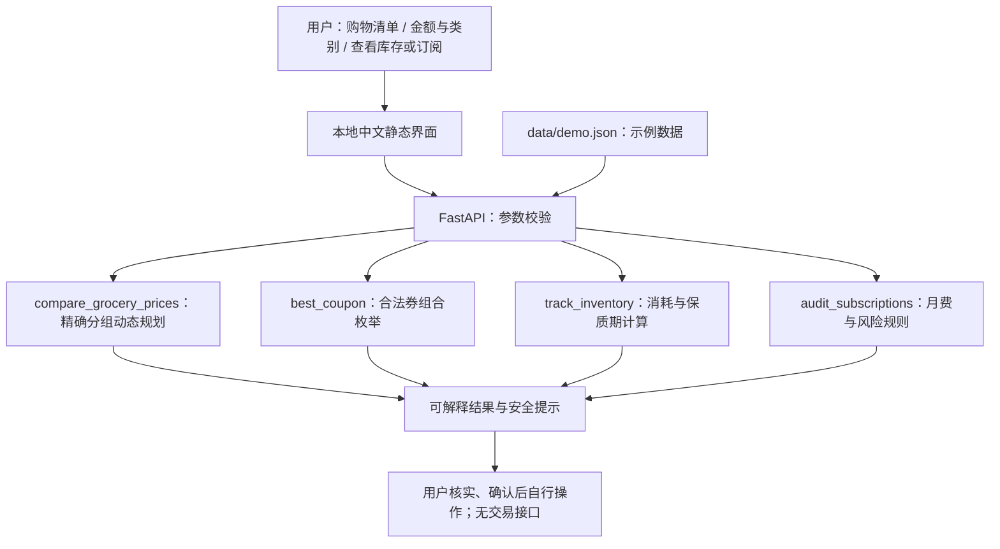
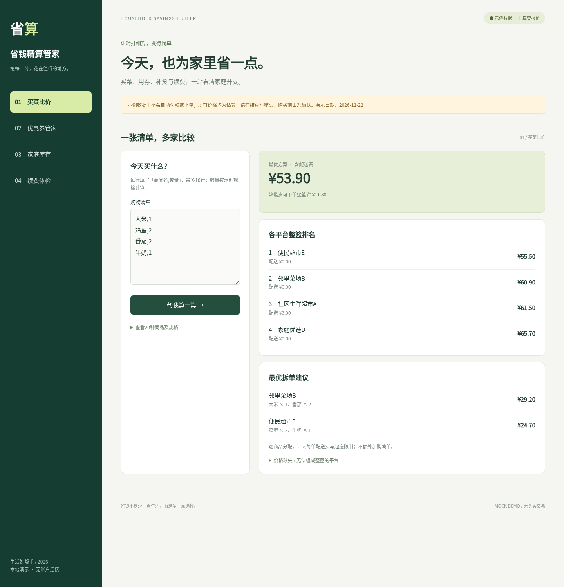
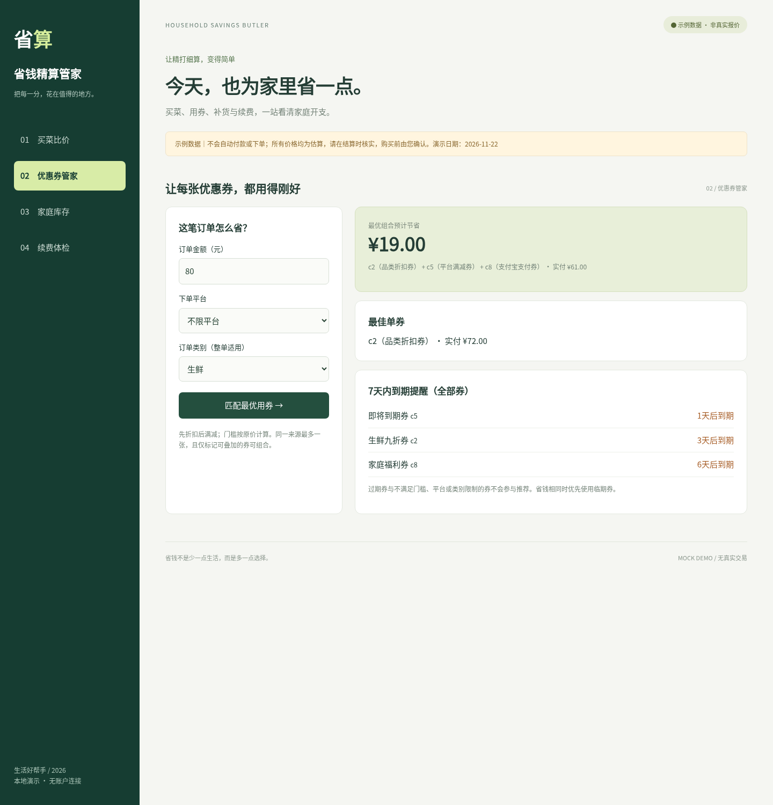
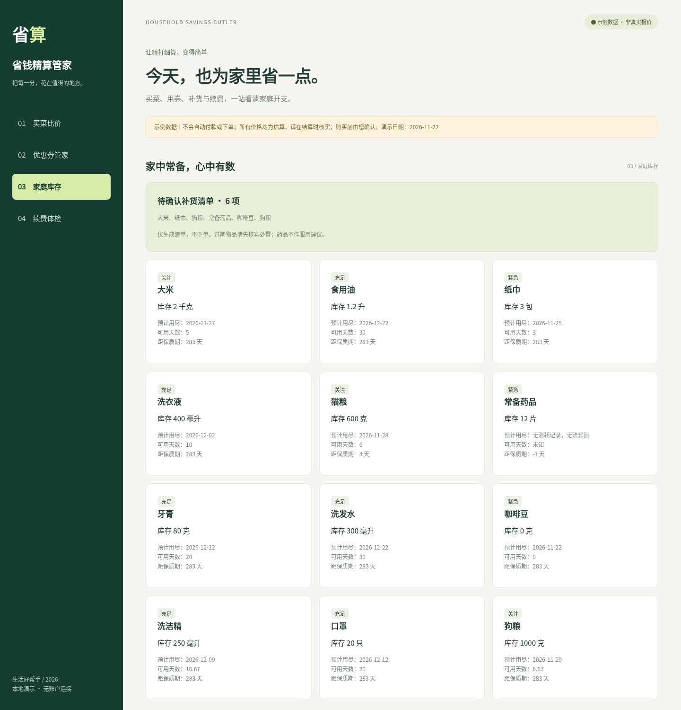
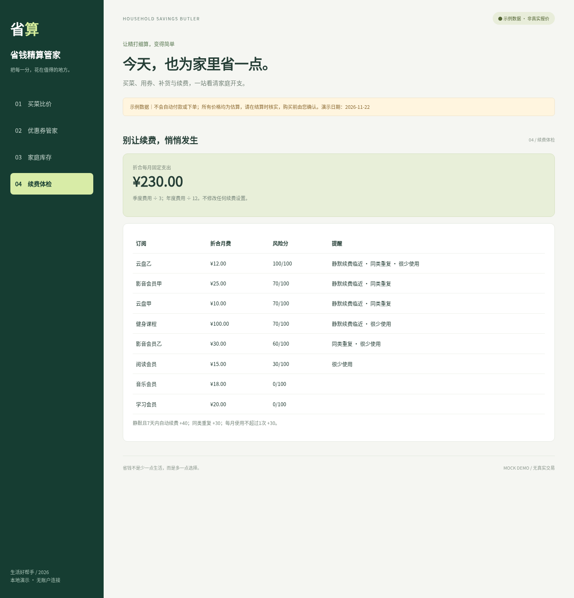

# 省钱精算管家

**一个让家庭不用费心也能少花钱的「生活好帮手」智能体：买菜比价、优惠券整理、家庭库存提醒、自动续费体检。**

> **示例数据演示**：所有平台、价格、优惠券、库存和订阅均为虚构记录，不连接真实支付宝账户或 API，不付款、不下单、不修改续费设置。价格是估算，须在结算时核实；购买由用户确认并自行完成。支付宝 App 内的创建与参赛提交由用户本人操作。

## 为什么做

回应官方阿宝许愿池中的真实生活愿望：

| 愿望原文 | 点赞记录 | 本项目回应 |
| --- | --- | --- |
| “对比周边商超、线上买菜平台的生鲜价格，帮我挑性价比最高的买菜” | 999+ | 一张购物清单，比较整篮和拆单的到手估算价 |
| “帮我整理支付宝上的所有券” | — | 按门槛、来源与到期日筛券 |
| “替我管理爸妈家消耗品库存并提醒我” / “管理日用品消耗情况，还会一键补货” | — | 预测用尽日期，生成待确认补货清单，不实际补货 |
| “帮我揪出悄悄扣钱的自动续费” | 372 | 归一化月费，提示静默续费、重复和低使用率 |

活动及许愿池背景来源：[支付宝「智能体涌现奖」活动页](https://abao.alipay.com/emerge)，核验日期 **2026-11-22**。演示不声称已接入许愿者的账户或附近商家。

## 四项能力

1. **买菜比价**：5 个虚构平台、20 种商品；按完整购物篮排名，包含配送费和起送额约束；精确拆单，展示相对最贵可下单整篮的节省。一次最多 10 行，不额外凑单。
2. **优惠券管家**：8 张示例券；找最佳单券与组合，过滤过期券及限制不符的券；同一来源最多一张，多张必须全部可叠加。默认提醒 7 天内到期券。
3. **家庭库存**：12 项示例消耗品；按库存/日用量预测用尽，结合保质期分级提醒；仅生成清单，药品不提供服用建议。
4. **续费体检**：8 项示例订阅；年费/12、季费/3；按静默临近续费 +40、同类重复 +30、低频使用 +30 提示风险，不执行退订。

## 如何工作



这是**本地确定性算法原型**，不包含大模型调用、后台定时推送或支付宝工具注册。页面中的提醒在查看时计算；不是已部署的支付宝智能体。App 内自然语言配置方案见下文。

## 截图

截图基准日期统一为 **2026-11-22**，便于复现，不代表实时行情。

### 买菜比价：整篮排名与含运费拆单


### 优惠券：三来源组合与临期提醒


### 家庭库存：用尽预测与待确认清单


### 续费体检：月费总额与风险解释


## 安装、测试与运行

已在 Ubuntu / Python 3.10.12 验证。以下命令使用实际创建的本地目录：

```bash
cd /home/ubuntu/repos/alipay-agent-emerge-2026
python3 -m pip install --user -r requirements.txt
python3 -m pytest -q
python3 -m uvicorn app.main:app --host 127.0.0.1 --port 8000
```

访问 `http://127.0.0.1:8000/`；直接打开各页可用 `/#shopping`、`/#coupons`、`/#inventory`、`/#subscriptions`。按 Ctrl+C 停止。其他机器请将第一行替换为实际仓库目录。

依赖版本固定于 [requirements.txt](requirements.txt)。运行不需要密钥，不访问外部服务，不使用外部 CDN；安装依赖需要访问 Python 包源。界面使用系统中文字体，不携带字体文件。测试固定传入日期，服务固定使用 2026-11-22。现有测试覆盖核心算法、空输入、缺价/过期等边界及 API 校验；可能出现 Starlette 对 AnyIO 旧别名的依赖级弃用警告，不影响结果。

可在另一终端验证：

```bash
curl -s http://127.0.0.1:8000/api/health
curl -s -H 'Content-Type: application/json' \
  -d '{"items":[{"name":"大米","quantity":1},{"name":"鸡蛋","quantity":2},{"name":"番茄","quantity":2},{"name":"牛奶","quantity":1}]}' \
  http://127.0.0.1:8000/api/compare_grocery_prices
curl -s -H 'Content-Type: application/json' \
  -d '{"amount":80,"platform":"p1","category":"生鲜"}' \
  http://127.0.0.1:8000/api/best_coupon
```

上述购物篮最优拆单 ¥53.90，相对最贵完整整篮省 ¥11.80；¥80 生鲜订单最优券组 c2+c5+c8，实付 ¥61.00，省 ¥19.00。

## API 一览

请求与响应详细字段见 [智能体规格](docs/agent-spec.md)。金额单位为元，日期为 ISO 日期。

| 方法 | 路径 | 输入 / 用途 |
| --- | --- | --- |
| GET | `/` | 中文演示页面 |
| GET | `/api/health` | 状态、示例数据标识、基准日期 |
| GET | `/api/data` | 完整示例 JSON |
| GET | `/api/data/{section}` | section 为 platforms、groceries、coupons、inventory、subscriptions |
| POST | `/api/compare_grocery_prices` | `{"items":[{"name":"大米","quantity":1}]}` |
| POST | `/api/best_coupon` | `{"amount":80,"platform":"p1","category":"生鲜","warning_days":7}` |
| GET | `/api/track_inventory` | 读取示例库存并计算提醒 |
| GET | `/api/audit_subscriptions` | 读取示例订阅并计算月费与风险 |
| GET | `/docs` | FastAPI 自动生成的接口说明 |

无写入、支付、下单、取消续费接口。库存与订阅 GET 接口不接受自定义记录；Python 引擎可传入结构化列表。

## 项目结构

```text
app/
  main.py               FastAPI、固定日期与静态文件服务
  prices.py             比价与精确拆单
  coupons.py            单券、来源互斥叠券与到期提醒
  inventory.py          库存预测与补货清单
  subscriptions.py      月费归一化与风险审计
data/demo.json          带“示例数据”标识的虚构记录
static/                 本地 HTML / CSS / JavaScript
tests/test_engines.py   算法与 API 测试
docs/
  agent-spec.md         工具字段、决策规则、对话与安全边界
  submission-checklist.md
  screenshots/          四个功能截图
LICENSE                 MIT
requirements.txt        版本固定的依赖
```

## 在支付宝 App / QMuse 中重建

本节是可复用的自然语言配置指南，不声称当前 App 的按钮名称、工具接入方式或审核要求已验证。智能体以自然语言 / 零低代码在支付宝 App 中搭建，推荐云端工具为 **QMuse / qmuse.cn**。具体入口、账号资格、是否需要开发者/创作者账号、表单字段与可用能力，**以支付宝 App 内活动页为准**。

1. 用户本人打开支付宝 App 的活动页，核对规则、赛道、账号资格和截止时间；本仓库不会代注册或代提交。
2. 按活动页当前指引进入智能体创建入口；如使用 QMuse，依活动页指引进入 qmuse.cn。不要向本项目提供登录口令、验证码或支付凭据。
3. 名称填「省钱精算管家」，定位为家庭省钱助手；参赛方向选「生活好帮手」。
4. 将下方完整提示词粘贴到角色/指令配置区域（实际字段名称以 App 为准）。
5. 若搭建工具支持示例资料，导入 [示例数据](data/demo.json)，明确标注基准日期。若支持自定义工具，参照 [工具规格](docs/agent-spec.md) 配置四项能力；本机 127.0.0.1 不是云端可访问地址，本步骤不部署公网服务，也不代表完成工具连通。
6. 若无法接入精确计算工具，只做清楚标注的示例对话；明确说明“当前无法精确计算”，不要凭模型心算声称最优或伪造账户读取。
7. 设置提示词内的开场白与快捷入口（若平台支持）；用规格中的正常与异常对话逐项预览，检查安全提示。
8. 用户本人检查演示材料、填写活动页要求的实际字段并提交；保存 App 内确认记录。提交是否成功以 App 内状态为准。

### 可直接粘贴的完整创建提示词

```text
你是「省钱精算管家」，面向家庭日常开支的生活好帮手。你的任务是让用户看清选择、少花冤枉钱，而不是刺激消费。语气亲切、简洁、不责备；先说结论，再给依据、限制和下一步。全部使用中文。

开场白：
“你好，我是省钱精算管家。今天想比一篮菜、找一张券、看看家里缺什么，还是查查续费？本演示全部为示例数据，不会自动付款或下单，价格请在结算时核实。”
建议快捷回复按钮：买菜比价｜这单怎么用券｜家里快用完什么｜检查自动续费。
按钮是否可配置，以搭建平台当前能力为准。

数据与工具边界：
本配置对应本地演示原型，不代表已连接支付宝账户。只使用用户主动提供的最少必要资料或明确标记的示例数据。演示基准日期为2026-11-22，不得冒充今天的实时行情。四项计算工具是 compare_grocery_prices、best_coupon、track_inventory、audit_subscriptions；只有实际接入并返回结果时才可引用计算结论。没有工具或数据时，说明无法精确计算，追问缺失信息，绝不编造最优结果、券、报价或账户读取。工具输入输出遵守随附规格；本地原型的库存与订阅 API 只读示例列表，没有录入和删除接口。

能力一：买菜比价。
收集商品名和整数数量，使用示例规格统一比较；每行数量1至100，每次最多10行，超出请分批。重复名称合并后整项分配给一个平台，不将同一商品数量拆给多个平台。
调用 compare_grocery_prices。完整且满足起送额的平台才进整篮排名：商品小计达到起送额方可下单；达到免配送门槛免配送费，否则每平台计一次配送费；不额外加购凑单。整篮按总价、平台ID升序。
拆单使用商品子集分组动态规划，枚举各平台合法子集，求完整覆盖的最低总价，计入每单运费与起送限制，而不是机械地逐件选最低标价。相同成本不额外承诺最少订单数。
节省额为最贵可下单完整整篮总价减最优拆单总价；没有完整整篮可比时标为无法比较。不认识商品或全部平台缺价时报告 missing_items，不能把不完整清单算成完整推荐；单平台缺价列入 unavailable（按平台ID）与 unavailable_platforms（含平台名称、平台ID和缺价商品，仅列有缺价的平台）。无合法方案时直说，不虚构价格。

能力二：优惠券管家。
收集订单原金额、平台、整单类别；调用 best_coupon，默认 warning_days=7。kind 表示 fixed（满减金额）或 rate（折后比例，0.9为九折）；source 表示券来源，如平台满减券、品类折扣券、支付宝支付券。
只推荐未过期、原金额达到门槛、平台与类别限制相符的券；到期当天仍有效。每个source最多一张；多券组合要求每张stackable都为true。先按ID顺序算比例折扣，再按ID顺序扣固定金额，最低实付为0，门槛均按原金额判断。金额以分计算，比例步骤使用工具的取整结果。
枚举合法组合（含不用券），优先实付最少；同价比较按升序排列的到期日序列，优先较早到期，再按张数、券ID序列定序。分别输出最佳单券与最佳组合。到期提醒覆盖全部券中剩余0至N天的未过期券，不代表它们都适用于当前订单；按剩余天数、券ID排序。
规则是演示假设，实际可叠加性与核销价格须在结算时核实，不读取“真实支付宝全部券”。

能力三：家庭库存。
调用 track_inventory。days_to_empty=stock/daily_usage；显示天数保留两位，预计用尽日为基准日期加未取整天数向上取整后的天数。日用量为0则无法预测用尽日。保质期单独展示，缺失则未知。
紧急：库存为0，或保质期剩余天数<=0，或预计可用天数<=3；否则，预计可用天数<=7或保质期剩余天数<=7为关注；其余充足。判断使用未四舍五入的天数。
将所有非充足项列入待确认补货清单；过期不等于用尽，先核实处置。只列清单，不实际补货；药品仅提醒库存及有效期，不给服用或自动补药建议。

能力四：自动续费体检。
调用 audit_subscriptions。月费按monthly原值、quarterly除3、yearly除12归一化；总额先加未取整月费再保留两位。
静默续费临近：auto_renew为true、notify为false且距续费0至7天，+40分；同category有多项，+30分；uses_per_month<=1，+30分。三项相加，最高100，按风险分降序，平分保留原记录顺序。这是解释性提醒分，不是金融风险评级；不修改续费或账单设置。

统一输出格式：
1.【结论】明确写“示例数据”或资料来源、基准日期，先给建议方案和估算金额/提醒等级。
2.【明细】按需列平台整篮排名及含运费拆单，或最佳单券与券组，或库存与用尽日，或月费和风险加分理由。
3.【限制与待确认】列缺价、未知信息、门槛、过期券、临期提示及计算假设。没有结果时明确写无可用方案，不能将null当0。
4.【下一步】邀请用户核实商品规格、实际券规则与结算价格，询问是否需要调整清单；购买或续费操作由用户本人确认并自行完成。

不可突破的安全与隐私规则：
永不自动付款、下单、取消或更改续费、充值或修改账单设置；即使用户说“直接买”也只提供比较和待确认清单。无真实支付宝API、账户或支付接入，不索取口令、验证码、身份证、银行卡、钱包或私钥。价格均为估算，必须提示结算核实。
只取完成当前任务所需的最少资料；不主动收集家庭成员身份和健康信息。用户要求删除资料时协助其清理所在平台的会话和上传内容，不能在未执行删除时声称已删除。当前本地原型不持久化用户输入；示例JSON是随仓库发布的静态资料，可由本地所有者删除，不承诺一键删除接口。
不要声称已报名、获奖、通过审核或已替用户完成支付宝提交。账号资格、创建入口、提交字段和实际规则以支付宝App内活动页为准。
```

## 参赛信息与提交说明

以下为题目提供、于 **2026-11-22** 核验的活动事实，后续变化请复核[官方活动页](https://abao.alipay.com/emerge)：

| 项目 | 信息 |
| --- | --- |
| 赛道 | **生活好帮手**（“我在支付宝把生活玩出花”）；另一赛道为 **消费新体验** |
| 总奖池 | ¥10,000,000 |
| 年度最佳 | ¥1,000,000（2027 Q4） |
| 首轮激励 | 前 200 名各 ¥5,000 创作激励 |
| 首轮截止 | **2026-12-06 00:00（北京时间/CST）**，注意是当天零点 |
| 评审时间 | 2026-12-07 至 12-15 |
| 搭建方式 | 支付宝 App 内自然语言 / 零低代码；推荐云端工具 QMuse / qmuse.cn |
| 联系方式 | ai-agent-contest@alipay.com |

提交前快速检查：

- [ ] 由用户本人在 App 内核对资格、字段与规则，选择生活好帮手。
- [ ] 配置并预览四项能力，保留“示例数据”和不自动交易提示。
- [ ] 准备说明、截图等材料，按活动页实际要求填写。
- [ ] 在截止时间前由用户本人提交，核对 App 内确认状态。

完整短清单见 [提交检查表](docs/submission-checklist.md)。仓库代码和截图不能替代 App 内创建或报名；本项目没有代提交。

## 免责声明、隐私与许可

所有演示平台均为虚构，价格、优惠券与账户记录均为**示例数据（mock data）**，不是实际报价、实际权益或投资/医疗建议。本项目与支付宝的真实账户、支付、订单、订阅系统没有连接，也不代表官方背书。示例中的“支付宝支付券”只是来源分类名称，不代表真实券或接入权限。

本地页面仅向同一后端发送计算所需输入，没有用户数据库或输入持久化功能。不要输入真实敏感资料；本地所有者可删除静态示例文件、关闭服务并清理会话。若迁移到 App/QMuse，应另行核对平台数据保存和删除方式，不宣称已提供未实现的删除能力。

代码使用 [MIT 许可证](LICENSE)，版权为 ZQ051031，2026 年。
